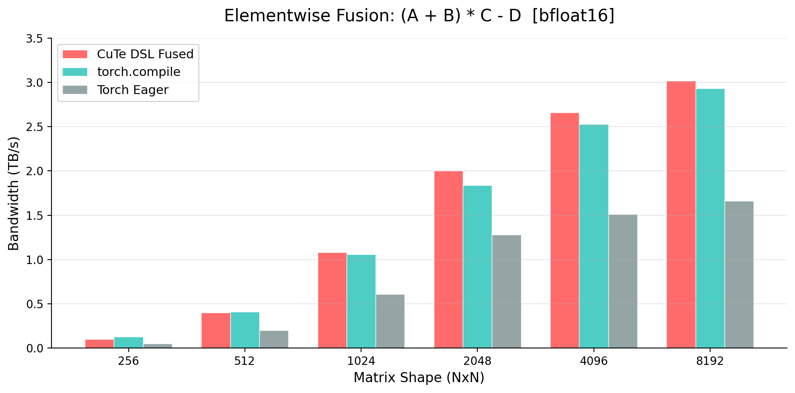

# cutest

Something cute

Elementwise kernel fuser built on NVIDIA CuTe DSL. Traces a computation graph and generates a single fused CUDA kernel.

## Usage

```python
import torch
from cutest import Tensor, execute

a = torch.randn(256, 256, device="cuda", dtype=torch.float32)
b = torch.randn(256, 256, device="cuda", dtype=torch.float32)
c = torch.randn(256, 256, device="cuda", dtype=torch.float32)
d = torch.randn(256, 256, device="cuda", dtype=torch.float32)

A, B, C, D = Tensor(a), Tensor(b), Tensor(c), Tensor(d)
E = (A + B) * C - D

result = execute(E)
```



`(A + B) * C - D` fused into one kernel, float16, benchmarked against `torch.compile` and PyTorch eager on H100.
